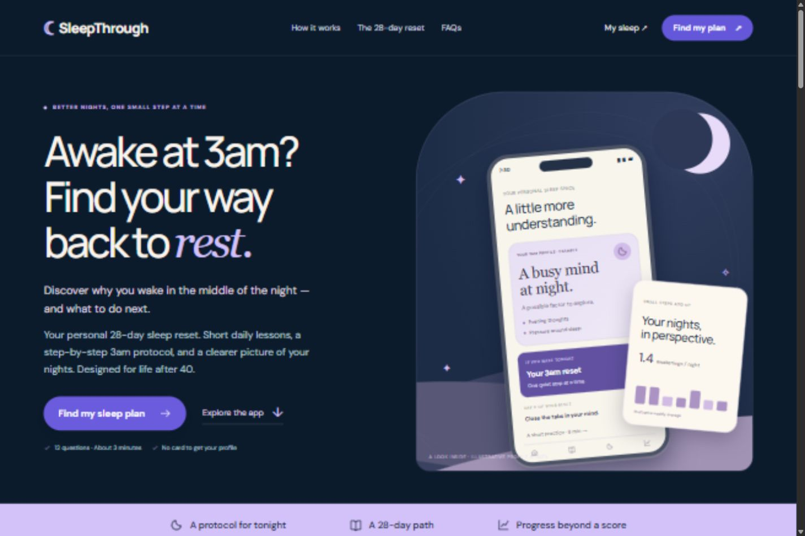

# SleepThrough

Интерактивный capstone-прототип продукта для людей, которые просыпаются среди ночи: продающий лендинг, персональный квиз, кабинет с аналитикой и 28-дневная система уроков.

**Демо:** https://sleepthrough-production.up.railway.app/#home



## Стек

| Часть | Реализация |
| --- | --- |
| Интерфейс | HTML5, CSS3, обычный JavaScript без фреймворка |
| Дизайн | Адаптивная CSS-вёрстка, SVG-иконки, макет телефона на HTML/CSS |
| Типографика | Manrope и DM Sans через Google Fonts; Georgia для отдельных акцентов |
| Навигация | Маршруты через URL hash: `#quiz`, `#dashboard`, `#lessons` |
| Состояние | JavaScript в памяти страницы; `localStorage` для прогресса, заметок и последнего чек-ина |
| Локальный сервер / Docker | Node.js 24+, встроенные `http`, `fs`, `path`; без сторонних npm-зависимостей |
| Текущая опубликованная версия | Railway Function, Bun 1.4.4, один сгенерированный TypeScript-файл |
| Альтернативный деплой из репозитория | Dockerfile с Node.js и `railway.json` |
| Проверки | Node.js `assert`, `vm`, HTTP-проверка статического сервера |

React, Next.js, Supabase и React Native в этой версии не используются. Сервер раздаёт файлы интерфейса; API для пользовательских данных и база данных пока не реализованы.

## Что работает

- **Лендинг:** хук «Awake at 3am? Find your way back to rest», описание программы и переход к квизу. Главный экран сохраняет тёмно-синюю, молочную и лавандовую палитру.
- **Квиз:** 12 вопросов о ночных пробуждениях, мыслях, режиме и желаемом результате.
- **Профиль:** возможные факторы, ответы, на которых основана рекомендация, дополнительный фактор и первая практика. Используются прозрачные правила, а не AI-модель или клиническая шкала.
- **Кабинет:** последняя записанная ночь, урок дня и демонстрационный график. Основная метрика — число пробуждений, а не Sleep Score.
- **28 уроков:** четыре недели, маршрут с объёмными узлами, следующий этап, недельная награда и 10 баллов за каждый уникально завершённый урок.
- **Урок:** объяснение → практика → рефлексия. Можно сохранить заметку и вернуться к шагу позже.
- **Журнал:** последний утренний чек-ин и сохранённые заметки из уроков.
- **Ночной протокол:** три коротких шага для момента пробуждения.

## Быстрый запуск

Нужен **Node.js 24+**. Сторонние зависимости устанавливать не требуется.

```bash
git clone https://github.com/Levinate/sleepthrough.git
cd sleepthrough
node server.cjs
```

Откройте http://127.0.0.1:3000.

Если npm доступен, можно использовать `npm run dev` или `npm start`. Сервер не включает автоматическое обновление страницы: после изменения файлов обновите вкладку.

Переменные окружения:

| Переменная | По умолчанию | Назначение |
| --- | --- | --- |
| `PORT` | `3000` | HTTP-порт |
| `HOST` | `127.0.0.1` | Интерфейс прослушивания; для контейнера используется `0.0.0.0` |

## Структура

```text
dist/
  index.html              # HTML-каркас, навигация и диалог чек-ина
  app.js                  # Экраны, маршруты, квиз, профили, обработчики
  lessons.js              # Содержание 28 уроков и четыре недели
  style.css               # Базовые стили и адаптивные состояния
  experience.css          # Лендинг, маршрут уроков и актуальный hero с телефоном
  design-notes.html       # Разбор конкурентов и продуктовых решений
  assets/night-waking.webp # Сохранённый визуальный материал предыдущего баннера
docs/
  STACK.md                # Подробности архитектуры и хранения данных
  DEPLOYMENT.md           # Railway: текущая Function и деплой через Docker
  PRODUCT.md              # Сценарии, решения по дизайну и бенчмарки
  preview.jpg             # Скриншот актуального первого экрана
scripts/
  build-railway.cjs       # Генератор одного файла для Railway Function
server.cjs                # Статический HTTP-сервер Node.js
check-flows.cjs           # Проверка логики приложения в модели DOM
check-server.cjs          # Проверка HTTP-сервера
Dockerfile
railway.json
package.json
```

Папка называется `dist`, но здесь это **редактируемые исходники интерфейса**, а не результат сборки React/Vite. Bundler не нужен.

## Команды

```bash
npm run check                    # Синтаксис сервера и JavaScript интерфейса
npm test                         # Логика продукта и HTTP-сервер
npm run build:railway-function    # Создать build/railway-function.ts
```

Без npm:

```bash
node --check server.cjs
node --check dist/app.js
node --check dist/lessons.js
node check-flows.cjs
node check-server.cjs
node scripts/build-railway.cjs
```

`check-flows.cjs` использует модель DOM и проверяет маршруты, 28 × 3 шага уроков, сохранение прогресса, экранирование заметок, 12 вопросов, профили, награды, периоды аналитики, чек-ин и ночной протокол. Это не полноценный браузерный E2E-тест. `check-server.cjs` запускает временный HTTP-сервер и проверяет загрузку файлов, HEAD, ошибки и запрет выдачи файлов вне `dist`.

## Публикация

Текущий сайт опубликован как **Railway Function**. Генератор собирает статические файлы в один самодостаточный файл `build/railway-function.ts`, который обслуживает Bun. Генерация файла сама по себе не загружает его в Railway.

Для обычного деплоя из GitHub подготовлены `Dockerfile` и `railway.json`. Подробный порядок и отличие двух вариантов описаны в [docs/DEPLOYMENT.md](docs/DEPLOYMENT.md).

**Автоматический деплой из этого GitHub-репозитория пока не подключён.** Изменения в GitHub не меняют уже опубликованную Railway Function автоматически.

## Данные и границы прототипа

- Ключ хранения — `sleepthrough-v3`. Сохраняются завершённые уроки, шаги уроков, заметки и **один последний чек-ин**. Истории отдельных чек-инов пока нет.
- Ответы квиза хранятся только в памяти текущей страницы и сбрасываются при её перезагрузке.
- Первый запуск содержит демонстрационный прогресс: семь завершённых уроков, следующий — день 8. Сброс доступен в журнале.
- Графики и цены — демонстрационные. Запись своей ночи обновляет карточку последней ночи и журнал, но не пересчитывает пример недельной аналитики.
- Имя Alex — демонстрационное; реальная авторизация, аккаунты, платежи, синхронизация, уведомления и интеграции с часами не подключены.
- Это веб-прототип. Android APK, iOS-сборка, TestFlight и публикация в магазинах приложений не подготовлены.
- Профиль предлагает возможные факторы и образовательную практику; он не устанавливает медицинскую причину пробуждений.

## Где менять содержимое

| Задача | Файл / функция |
| --- | --- |
| Текст первого экрана и макет телефона | `dist/app.js` → `landing()` |
| Палитра и базовая вёрстка | `dist/style.css` → `:root` |
| Актуальная композиция hero | `dist/experience.css` → `.showcase-*` |
| Вопросы квиза | `dist/app.js` → `quizQuestions` |
| Правила рекомендации | `dist/app.js` → `getSleepProfile()` |
| Темы и тексты уроков | `dist/lessons.js` |
| Маршрут обучения | `dist/app.js` → `lessonList()` |

Подробности: [стек и архитектура](docs/STACK.md), [продукт и бенчмарки](docs/PRODUCT.md).
