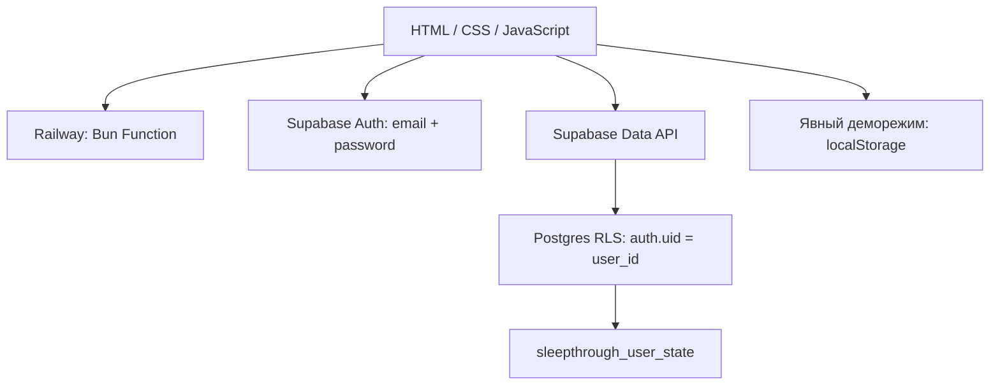

# Стек и архитектура

## Интерфейс

HTML5, CSS3 и обычный JavaScript без React и bundler. `dist` содержит редактируемые исходники. Навигация использует URL hash. Палитра: тёмно-синий `#0b1b2b`, молочный `#faf4ed`, лаванда `#d3c1fa`, фиолетовый `#6457d9`. Телефон и иконки сделаны HTML/CSS/SVG.

Шрифты Manrope и DM Sans загружаются через Google Fonts, предусмотрены системные замены. Интерфейс английский, документация русская.

## Авторизация и данные

**Supabase Auth + PostgreSQL + Row Level Security.** Проект SleepThrough в NOA, регион eu-central-1. В браузере используется официальный `@supabase/supabase-js` **2.119.0** через jsDelivr с закреплённой версией и SHA-384 SRI. npm-зависимости для запуска сервера не нужны: SDK загружается отдельно браузером.

`config.js` содержит API URL и **publishable key**, предназначенный для публичного клиента. Секретный ключ и `service_role` не используются. Доступ определяет JWT пользователя и RLS, а не имя из user metadata.

`auth.js` управляет сессией, регистрацией, входом, подтверждением email, восстановлением пароля и очередью сохранений. При открытии существующая сессия проверяется через `getUser()`. Восстановление пароля доступно после события `PASSWORD_RECOVERY` из письма. SDK сохраняет сессию в браузере и обновляет токены.

`account.js` содержит формы и личную аналитику. `app.js` подключает кабинет, уроки и дневник к аккаунту. Гостям показывается вход; `#demo` отдельно открывает пример с Alex и иллюстративной аналитикой.

## Модель хранения

Одна строка `public.sleepthrough_user_state` на пользователя:

| Поле | Значение |
| --- | --- |
| `user_id` | UUID из `auth.users`, первичный ключ |
| `display_name` | Имя для интерфейса, максимум 80 символов |
| `payload.complete` | Уникальные завершённые уроки 1–28 |
| `payload.notes` | Рефлексии до 1500 символов на урок |
| `payload.lessonSteps` | Последний шаг каждого урока |
| `payload.history` | До 366 утренних записей |
| `updated_at` | Время записи |

Одна запись на локальную календарную дату; повторный чек-ин обновляет текущий день. Аналитика вычисляет средние пробуждения, минуты бодрствования и часы сна по записанным ночам за 7/28 дней. Пропуски исключаются из среднего. Новый аккаунт начинается с пустой истории и нуля завершённых уроков; демоданные не импортируются автоматически.

Сохранения идут последовательно с задержкой 600 мс и видимым статусом. Ошибка загрузки блокирует редактирование, чтобы пустое состояние не затёрло облачные данные. При ошибке сохранения доступен Retry; выход блокируется, пока изменения не сохранены. Выход очищает данные текущего пользователя из состояния интерфейса.

**Ограничение:** это одна JSON-строка без слияния одновременных изменений с разных устройств. Последняя запись выигрывает. Для массового продукта дневник нужно нормализовать и добавить контроль версий.

Схема и политики — `database/schema.sql`. RLS ограничивает SELECT/INSERT/UPDATE/DELETE владельцем строки. Публичная роль `anon` не имеет доступа. Текст пользователя экранируется перед HTML-вставкой.

Деморежим сохраняет прогресс, заметки и последний чек-ин в `localStorage` под `sleepthrough-v3`. Он не синхронизируется. Ответы квиза остаются в памяти страницы.

## Анимации

CSS-анимации появления экранов, карточек, завершения урока, столбцов аналитики, мягкого движения декора. IntersectionObserver включает появление секций. `prefers-reduced-motion` отключает движение. Нет таймеров, штрафов и давления через серии.

## Квиз и уроки

12 вопросов и прозрачные правила `getSleepProfile()`: мысли, давление вокруг сна, режим, окружение или нейтральный профиль. Это образовательные рекомендации, не AI и не диагностика. 28 уроков: объяснение → практика → рефлексия.

## Хостинг

Production — Railway Function на Bun 1.4.4. `scripts/build-railway.cjs` сжимает интерфейс в один TypeScript-файл менее 96 KB. SDK грузится с CDN. Историческое изображение баннера не включено в Function: текущий hero использует CSS.

Локальная разработка и альтернативный Docker-деплой — Node.js 24 со встроенными `http`, `fs`, `path`. `/health`, GET/HEAD, раздача только `dist`, `no-cache` для JS/CSS/HTML. `Dockerfile` запускает сервер от пользователя `node`.

## Проверки и границы

Node `assert`/`vm` проверяют продуктовые сценарии, auth-сервис с SDK-моделью, очередь/ошибки сохранения и смену аккаунта. HTTP-проверка запускает настоящий локальный сервер. На живой базе выполнен транзакционный тест RLS для двух временных пользователей: изоляция чтения, своё обновление, запрет чужого обновления/удаления и смены владельца; фикстуры откатились. Security Advisor не сообщил замечаний к схеме.

**SMTP ещё требуется настроить:** Site URL и production redirect направлены на Railway. Встроенная почта Supabase ограничена адресами команды организации; для регистрации клиентов и восстановления пароля нужен собственный SMTP. Полный сценарий письма и входа реального пользователя пока не проверен.

Платежи, уведомления, iOS и магазины приложений не подключены. Android pilot с нативными Health Connect/Keystore добавлен отдельно: [mobile/README.md](../mobile/README.md). Реальный Samsung-импорт на телефоне и письма авторизации требуют проверки. Подробнее об исходной веб-авторизации: [AUTH.md](AUTH.md).
