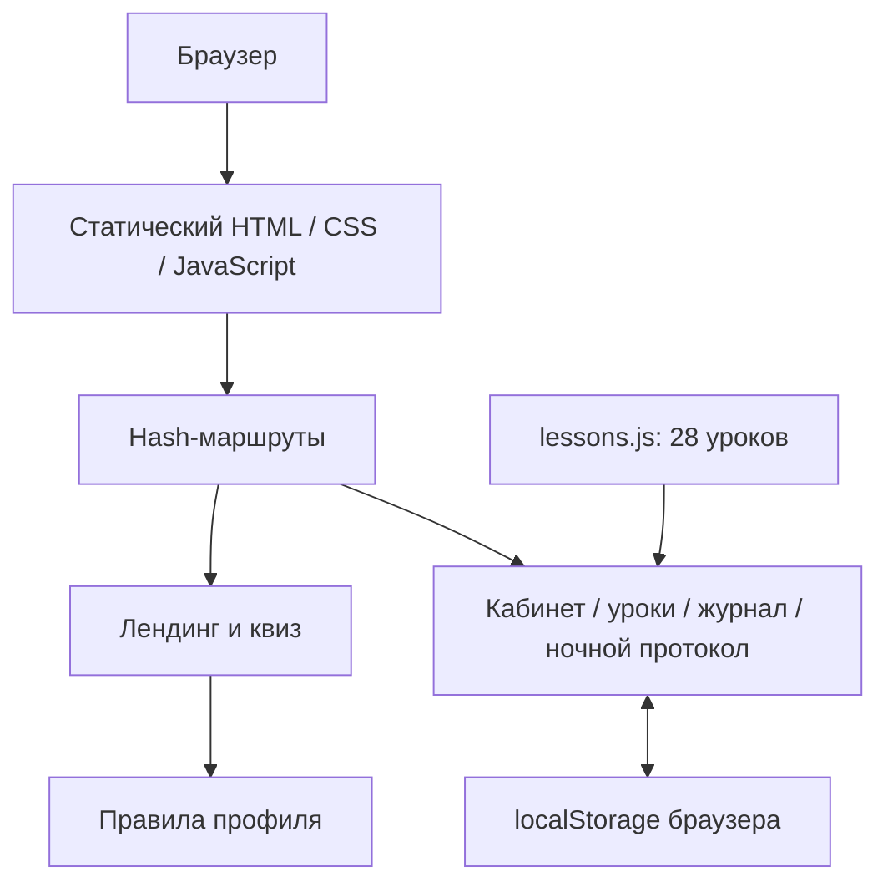

# Стек и архитектура

## Текущая реализация

SleepThrough — одностраничный сайт на HTML, CSS и JavaScript. Он работает в браузере без клиентских библиотек и без этапа сборки. `index.html` подключает стили, затем `lessons.js` и `app.js`.

`lessons.js` содержит четыре недели и 28 уроков. `app.js` хранит состояние и формирует HTML экранов в `main`. Навигация реагирует на событие `hashchange`.

## Интерфейс

- **HTML5:** семантические секции, формы, `dialog`, `details`, ссылки и кнопки.
- **CSS3:** Grid, Flexbox, медиазапросы, градиенты, трансформации, состояния фокуса и `prefers-reduced-motion`.
- **SVG:** небольшие иконки встроены в разметку. Макет телефона и иллюстрация на главном экране сделаны HTML/CSS; это не скриншот приложения.
- **Шрифты:** Manrope и DM Sans загружаются через Google Fonts. При недоступности сети используются системные замены. Georgia используется для редакционных акцентов.
- **Язык интерфейса:** английский. Markdown-документация написана по-русски для команды capstone.

Основные цвета: `#0b1b2b` — фон, `#faf4ed` — молочный текст, `#d3c1fa` — лаванда, `#6457d9` — фиолетовые действия. Отдельные поверхности телефона светлые для читаемости демонстрации.

## Состояние и хранение

Объект `state` содержит текущий экранный выбор, ответы квиза, период аналитики, неделю, шаги уроков и локальные записи.

В `localStorage`, под ключом `sleepthrough-v3`, сохраняются:

| Поле | Данные |
| --- | --- |
| `complete` | Массив номеров завершённых уроков |
| `notes` | Текст рефлексии по номеру урока |
| `entry` | Последний чек-ин: пробуждения, минуты бодрствования, часы сна, самочувствие и дата |
| `lessonSteps` | Шаг, на котором пользователь остановился в каждом уроке |

Данные не отправляются на сервер. `localStorage` относится к конкретному origin и браузеру: локальная версия, Railway и другая копия сайта не разделяют записи. Это не облачный аккаунт и не зашифрованное медицинское хранилище.

Текст заметок экранируется перед вставкой в HTML. Очистка демоданных доступна из журнала с подтверждением.

## Квиз

12 вопросов покрывают цель, длительность и частоту проблемы, время пробуждения, субъективное время бодрствования, мысли, реакцию ночью, режим, вечерние привычки, дневное влияние и удобный формат начала.

`getSleepProfile()` складывает простые баллы по нескольким ответам и выбирает один из профилей:

1. Midnight overthinker — занятый мыслями ум.
2. Clock watcher — давление вокруг необходимости уснуть.
3. Shifting rhythm — меняющийся режим.
4. Sensitive sleep space — свет, звук, температура или комфорт.
5. Нейтральный результат, если явного сигнала нет.

Результат объясняет основания, показывает дополнительный фактор при наличии и предлагает конкретный урок. Это вручную заданные правила продукта, не машинное обучение, диагностика или оценка по валидированной клинической шкале.

## Серверы и хостинг

### Уже опубликованная версия

Railway Function на Bun 1.4.4. Генератор использует Node.js `zlib` и кодирует статические файлы в один исходник. Во время старта Bun распаковывает их в память и отвечает на HTTP-запросы. Внутри функции нет базы данных, пользовательского API и записи персональных данных.

### Сервер в репозитории

`server.cjs` использует только встроенные модули Node.js. Он раздаёт разрешённые типы файлов из `dist`, обрабатывает query-параметры версий, HEAD и `/health`. Файлы проекта за пределами `dist` не выдаются. JS и CSS возвращаются с `no-cache`, чтобы изменения интерфейса не застревали в кеше.

Docker запускает этот сервер под пользователем `node`. Это подготовленный вариант для деплоя из GitHub; он не заменяет текущую опубликованную Function автоматически.

## Что добавлять для полноценного продукта

Следующие пункты пока не реализованы: авторизация, серверная модель пользователя, история чек-инов, расчёт графиков по реальным записям, синхронизация, платежи, уведомления и мобильные сборки. Выбор фреймворка и базы для этого этапа остаётся отдельным решением; наличие этих технологий не заявляется как часть текущего стека.
